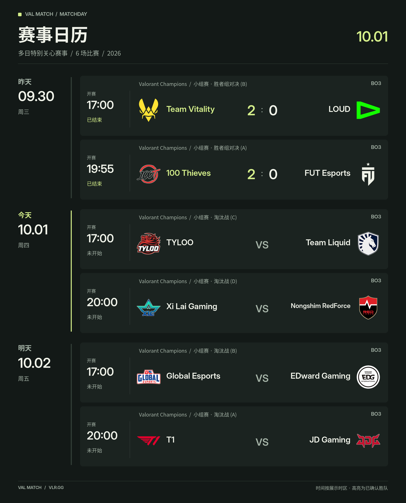
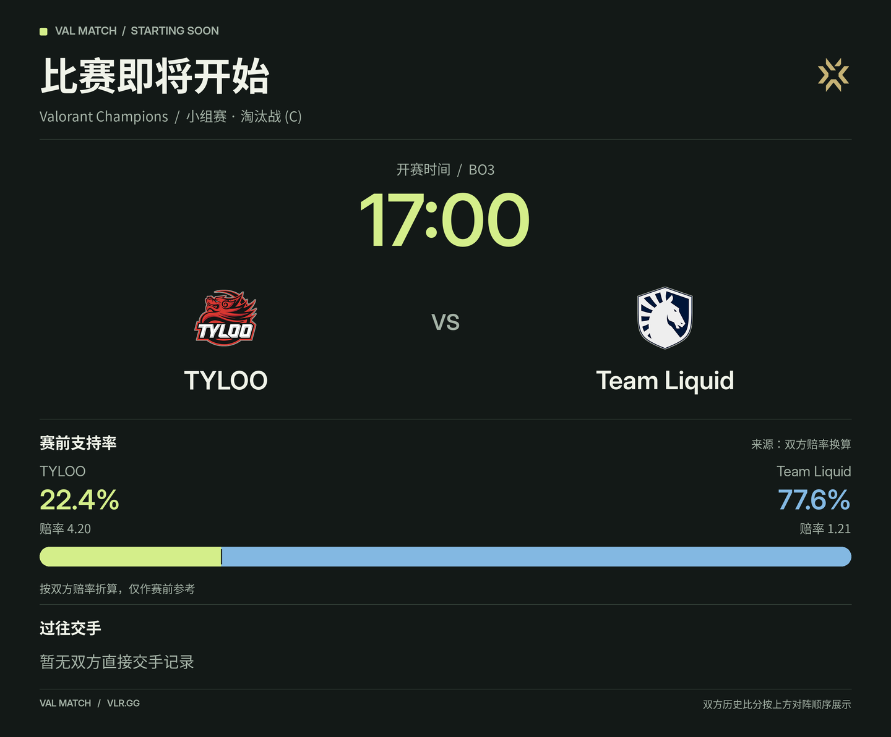
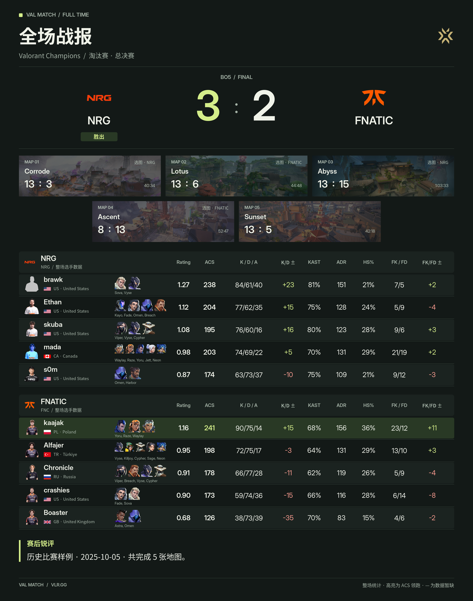

# VAL Match

无畏契约赛事助手：查询赛程、推送赛况与战报，在群内用自然语言竞猜比分，并在比赛结算后自动发送积分榜。


数据来自 VLR.gg，默认使用北京时间。基础赛程查询无需配置额外 API Key。

## 功能

- **赛程与赛况**：今天、明天、指定日期和多日赛事日历；赛事积分榜、淘汰晋级图和当前比赛状态。
- **订阅与提醒**：特别关心赛事多选，每日定时推送、开赛提醒、逐图赛果和全场战报。
- **完整战报**：地图比分、选图方、时长，以及十名选手的头像、国家、英雄、Rating、ACS、K/D/A、KAST、ADR、HS%、首杀等统计。可选 AI 赛后锐评。
- **群内竞猜**：真实 @机器人后直接说队名和整场比分，支持简称、中文数字、批量提交和修改。
- **积分与正确率**：每群独立计分，自动结算；积分榜展示胜负预测正确率和参与、结算场数。
- **赛后自动发榜**：可按群启用，等当天全部竞猜比赛结束及结算后发送，跨午夜继续等待。
- **机器人参赛**：可独立结合过往交手、近期表现和比赛信息预测，群成员无法修改机器人竞猜。
- **内置控制台**：在 AstrBot 插件详情页查看赛程时间轴、竞猜、排行榜、任务与事件，并调整设置。
- **Studio 图片主题**：炭黑与暖白两套风格，大队标、固定文字区域、状态配色；开赛提醒保留赔率和支持率双色对比条。

## 效果展示

以下为保存的历史赛事数据，展示图片效果，不是实时赛程。

<details open>
<summary>赛事日历</summary>



</details>

<details>
<summary>开赛提醒与支持率</summary>



</details>

<details>
<summary>完整战报（五张地图）</summary>



</details>

## 安装

需要 **AstrBot >= 4.28.1、< 5** 和 **Python >= 3.12**。已验证 Linux / OneBot v11（`aiocqhttp`）；其他平台尚未完成完整测试。

在 AstrBot 的“插件”页面选择“安装插件”，填入：

```text
https://github.com/Kelvin18710/astrbot_plugin_val_match
```

AstrBot 会根据 `requirements.txt` 安装 Python 依赖。基础查询不需要 AI；机器人预测和 AI 锐评使用 AstrBot 当前配置的模型提供商。

### 图片字体

图片需要中文字体。Debian / Ubuntu 或对应 Docker 容器内安装：

```bash
apt-get update
apt-get install -y fonts-noto-cjk
```

默认中文字体位置为 `/usr/share/fonts/opentype/noto/NotoSansCJK-Regular.ttc`。Studio 在缺少 Inter 时回退到 Noto Sans CJK。字体必须安装在运行 AstrBot 的环境内。

## 快速开始

1. 在插件详情页打开 **赛事控制台**。
2. 进入“设置”，勾选 **特别关心赛事**；需要推送时再选择目标群并启用对应开关。
3. 在群里执行 `/val today` 或 `/val s`，确认数据与图片正常。

竞猜需要另外启用“群内竞猜”并选择竞猜目标群。时区默认 `Asia/Shanghai`，可在设置中修改。

## 群内竞猜

群成员需要 **@机器人**，可以直接说：

```text
@机器人 今日竞猜
@机器人 我猜 EDG 2比1 赢 PRX
@机器人 把 EDG 那场改成 2:0
@机器人 我猜 EDG 2:1 赢 PRX，FNC 2:0 赢 DRX
@机器人 把 EDG 那场改成 2:0，然后把 FNC 那场改成 1:2
@机器人 我的竞猜
@机器人 积分榜
@机器人 竞猜怎么玩
```

竞猜只开放 **今日比赛**，不支持提前竞猜未来赛程。比分是整场地图比分，例如 BO3 为 2:0、2:1 及反向比分；平局、单图回合比分和不符合赛制的比分会被拒绝。

**开赛前 10 分钟封盘**，之后无法提交或修改；提前开赛也会封盘。每人每场保留最后一次有效竞猜。批量逐场反馈，一场非法或封盘不影响其他明确有效的竞猜；重复报同一场或不确定表达会要求澄清。

每个成员初始 **0 分**，每群积分独立：

| 结果 | 本场积分 |
| --- | ---: |
| 猜中胜队，比分未完全一致 | 2 |
| 胜队和比分均命中 | 5 |
| 胜队未命中 | 0 |

**胜负正确率 = 猜中胜队的场数 / 本人参与且已结算的竞猜场数**。未参与、未结算比赛不计入分母，没有已结算竞猜时显示“暂无”。机器人按相同口径计分和统计。

## 积分榜什么时候发送

在控制台“积分榜播报”中选择：

- **定时模式**：按设置的时间每日发送。
- **赛后模式**：启用“比赛结束后自动发送积分榜”，选择对应竞猜群。所选群等待当天全部已确认竞猜比赛取得最终赛果、积分结算完成后发一次；其余群保留定时设置。

无比赛当天不发赛后榜。跨午夜、比赛顺延和重载都会保留待处理比赛日；发送失败重试，确认成功后持久化去重。群成员可随时 @机器人查看即时积分榜。

## 常用命令

| 命令 | 用途 |
| --- | --- |
| `/val today` | 今日赛程 |
| `/val tomorrow` | 明日赛程 |
| `/val s` | 多日赛事日历图片 |
| `/val progress` | 赛事积分榜或淘汰晋级图 |
| `/val sync_events` | 同步可选赛事列表 |
| `/val debug` | 查询数据源与配置状态 |

完整命令与配置项见 [配置参考](docs/CONFIGURATION.md)。

## 数据与运维

竞猜、积分和发送记录保存在 AstrBot 的 `data/plugin_data/astrbot_plugin_val_match/predictions.sqlite3`，重载后保留。图片和网页缓存自动生成，不包含在发布包中。

只有明确的竞猜、修改或查询意图才进入竞猜处理；询问“预测今年冠军”等普通讨论仍交给正常聊天。VLR 访问失败或无法确认比赛状态时，不保存未经核实的竞猜。

## 开发与许可

发布版通过本地回归测试，代码使用 Ruff 格式化：

```bash
python -m unittest discover -s tests
ruff check .
ruff format --check .
```

开发文件保留在仓库，插件 ZIP 通过 `.gitattributes` 排除测试和工具。更新内容见 [CHANGELOG](CHANGELOG.md)。

插件代码采用 [MIT](LICENSE)。外部赛事素材、队标、选手与英雄图像的权利归各自权利人，详情见 [资源说明](assets/ATTRIBUTION.md)。
